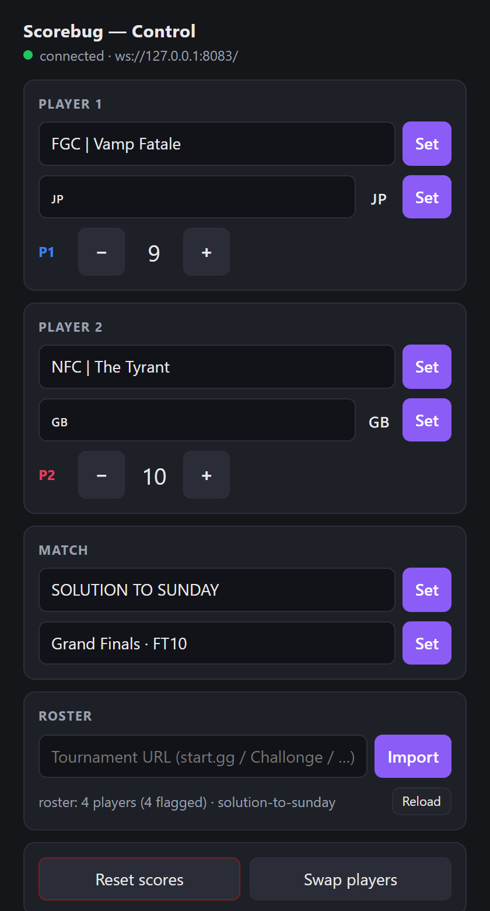

# Tally

**A Streamer.bot-native tournament scorebug** for OBS, Streamlabs Desktop, XSplit — any
streaming app with a browser source. Player names, scores, and nationality flags on
stream — driven from **Twitch chat**, a **Stream Deck**, **hotkeys**, or a small
**browser control panel**. No dedicated server: Streamer.bot serves the overlays and
holds the state.


Type `!sb p1flag japan` in chat and the flag appears. Import a start.gg or Challonge
bracket once and every entrant's name autocompletes in the control panel — with their
flag. Made for FGC / esports streams that run fast matches and don't want to alt-tab.

| | |
|---|---|
| **Overlay** | the bundled **Primetime** theme — an ESPN-style title plate + one combined strip per player (score · flag · name), with auto-fit type and score-bump/name-swap animation |
| **Teams** | 2 by default, up to **4** (`!sb teams 4` — see below); or use a single strip as a plain on-stream **counter** (deaths, attempts, …) |
| **State** | a handful of Streamer.bot global variables (persist across restarts) |
| **Control** | chat commands, Stream Deck, hotkeys, and `tally-shared/control.html` |
| **Roster** | import a bracket (start.gg, Challonge, TourneyBot, Matcherino, RoundOne) → name autocomplete + flag autofill |
| **Needs** | Streamer.bot (tested on 1.0.4 and 1.0.7) + a streaming app with a browser source (see below). Node.js 18+ only for the roster import and the local no-SB mock — the scorebug itself runs on Streamer.bot alone |

**Works with any streaming software whose browser source is Chromium-based (≥ 80, i.e.
anything from 2020 on):** the panels are plain web pages loaded from
`http://127.0.0.1:7474` that open a WebSocket to Streamer.bot — nothing OBS-specific.
OBS and Streamlabs Desktop use the same CEF browser source; current XSplit Broadcaster
works too (old XSplit builds shipped an ancient engine — update if panels stay blank).
Where this README says "Browser Source", use your app's equivalent (XSplit: *Webpage*).

## Quick start

First, get the code onto the machine that runs Streamer.bot — either

```
git clone https://github.com/FlashGalatine/tally-scorebug.git
```

or click **<> Code → Download ZIP** on the repo page and extract it. The
`<repo>` paths below refer to that folder.

1. **WebSocket Server** — Streamer.bot → *Servers/Clients → WebSocket Server*: enable,
   `127.0.0.1:8080`, authentication **off**. (`8080` is only Tally's default, not a
   requirement — if the port is taken, run SB's WS server anywhere and append
   `?sbport=<port>` to every panel/control-panel URL, e.g. `…/title-309x49.html?sbport=9090`.
   For a non-localhost host, set `window.__SB_WS_URL = 'ws://host:port/'` in a `<script>`
   tag *before* the `panel-core.js` include instead. Auth off *is* a requirement.)
2. **HTTP Server** — *Servers/Clients → HTTP Server*: enable, `127.0.0.1:7474`, add two
   Path → Folder mappings (folders from wherever you cloned this repo):

   | Path | Folder |
   |---|---|
   | `tally-themes` | `<repo>\tally-themes` |
   | `tally-shared` | `<repo>\tally-shared` |

   (The `tally-` prefix keeps these paths from colliding with other Streamer.bot
   add-ons that serve generic `themes`/`shared` folders. **Upgrading from an older
   Tally that used `themes`/`shared`?** Update both mappings and re-point your
   browser-source URLs below — the old `/themes/…` and `/shared/…` URLs will 404.
   Themes ported from StreamScoreboard need their panels' `panel-core.js` src
   repointed too — see [docs/THEMING.md](docs/THEMING.md).)

3. **Two actions** — Actions → new action named **exactly** `Scoreboard Push`; add a
   sub-action *Core → C# → Execute C# Code*; paste [`actions/scoreboard-push.cs`](actions/scoreboard-push.cs);
   **Compile**. Repeat for `Scoreboard Command` with
   [`actions/scoreboard-command.cs`](actions/scoreboard-command.cs). Both compile with **no
   added references**. (The names matter: panels request `Scoreboard Push` on connect, and
   `Scoreboard Command` runs it by name.)

   **Put both actions in one blocking queue.** In Streamer.bot's action queues, add a
   queue (call it `Tally`) with **Blocking** turned on, then set that queue on both
   `Scoreboard Push` and `Scoreboard Command`. Do not leave them in the default queue.
   In the default queue Streamer.bot can run two requests for the same action at once,
   and when it does, both runs see one request's arguments and the other command is lost.
   A blocking queue runs them one at a time, in the order they arrived. Measured on
   Streamer.bot 1.0.7: two back-to-back commands mixed their arguments in 25 of 25 tries
   in the default queue, and in 0 of 25 in a blocking queue, whether they came from one
   client or two. This covers the control panel, chat and Stream Deck together.
4. **Your streaming app** — add a Browser Source (OBS/Streamlabs) or Webpage source
   (XSplit) per panel, at its native size:

   ```
   http://127.0.0.1:7474/tally-themes/primetime/panels/title-309x49.html            (309×49)
   http://127.0.0.1:7474/tally-themes/primetime/panels/player1-strip-545x63.html    (545×63)
   http://127.0.0.1:7474/tally-themes/primetime/panels/player2-strip-545x63.html    (545×63)
   ```

5. **Drive it.** Create a chat command `!sb` (Commands tab), then — the step that's easy to
   miss — open the `Scoreboard Command` action and **add the command as a Trigger** on it
   (Triggers box → search the command's name). Then, in chat:

   ```
   !sb header SOLUTION TO SUNDAY      !sb p1name FGC | Vamp Fatale
   !sb subheader Grand Finals · FT10  !sb p1flag japan
   !sb p1+                            !sb swap
   ```

   **Restrict who can use the command.** `Scoreboard Command` does whatever the chat
   command passes it and does not check who typed it. In the `!sb` command's own settings
   (Commands tab), set its permissions so only **moderators** and the **broadcaster** can
   use it. Anyone the command allows can put any text on the overlay
   (`!sb p1name …`, `!sb header …`), reset the scores, or change the team count. The same
   applies to every other chat command you point at this action.

A panel added mid-match paints immediately: on connect it asks Streamer.bot to re-broadcast
current state (there is no "blank until the next update").

## Commands

Everything runs through the one parametric `Scoreboard Command` action:

| `command` | `value` | Effect |
|---|---|---|
| `p1+` `p1-` `p2+` `p2-` | — | score ±1 (clamped 0–99) |
| `p1score` `p2score` | number | set a score directly |
| `reset` | — | all scores → 0 |
| `swap` | — | swap players 1 and 2 (name + score + flag) |
| `p1name` `p2name` | text | set a name — `Sponsor \| Player` renders as a sponsor plate |
| `p1flag` `p2flag` | nation | set the nationality flag (see below) |
| `header` `subheader` | text | match title / subtitle |
| `teams` | 2–4 | enable/disable the optional 3rd and 4th slots (see below) |

Every `p1`/`p2` command also exists as `p3`/`p4` (`p3+`, `p4name`, `p3flag`, …) — they
drive the extra slots of teams mode.

There is one optional extra argument: alongside `command=pNname` you may pass **`flag`**,
and that player's name and nation are applied in a single invocation. The control panel
uses it so one **Set** click sends exactly one `DoAction` — Streamer.bot (seen on 1.0.4
and 1.0.7) mixes the arguments of two `DoAction`s whose runs of the same action overlap,
so a burst silently loses one of them. Chat and Stream Deck never need it. The blocking
queue in setup step 3 is what stops the overlap; one call per click keeps the panel safe
on installs that have not set it.

For the same reason there is a batched command, **`setmany`**: each sibling argument
present among `p1name`…`p4name`, `p1flag`…`p4flag`, `header`, `subheader` is applied in
one invocation (absent ones untouched; a bad flag warns and skips just that field). The
control panel uses it to flush every edited-but-unset field on any **Set** click — edit
Player 1 *and* Player 2, click Set once, both land. Chat and Stream Deck never need it.

### Three or four teams (optional)

The scorebug is two slots out of the box. For 3- and 4-way formats (crew battles,
free-for-alls, team leagues), send `teams 3` or `teams 4` (chat: `!sb teams 4`; the
control panel has a **Teams** selector). From then on every broadcast includes
`player3`/`player4`, the control panel grows a **Player 3** / **Player 4** card, and the
`p3*`/`p4*` commands (and their dedicated-command variants `!p3+`, `!p4name`, … — add
them as triggers like the others) drive them. Add the extra Primetime strips as sources:

```
http://127.0.0.1:7474/tally-themes/primetime/panels/player3-strip-545x63.html   (545×63, green)
http://127.0.0.1:7474/tally-themes/primetime/panels/player4-strip-545x63.html   (545×63, gold)
```

The P3/P4 strips render blank until teams mode reaches them, so you can leave the
sources in your scene permanently. `teams 2` returns to the classic scorebug without
erasing the extra slots' names/scores (they come back on the next `teams 3`/`4`), and
two-team broadcasts keep the exact original payload shape, so custom themes that only
know `player1`/`player2` are unaffected. `swap` always swaps slots 1↔2 — with more
teams, re-set names directly.

### Not just scores — use it as a counter

Nothing says a slot has to be a player. A strip is just a **name + a number driven from
chat, a Stream Deck, or a hotkey**, which makes it a ready-made on-stream tally for
anything you'd otherwise count on a sticky note:

- **Souls-like death counter** — `!sb p1name Deaths`, hide the P2 strip (or run a
  one-slot layout), and bind `p1+` to a Stream Deck key. `!sb p1score 57` corrects it.
- **Attempt counter** — "Attempts at this jump": `p1+` per try, `reset` on a new
  obstacle, `header`/`subheader` as the challenge title.
- **Running gags** — times the streamer noticed the same background NPC, rage quits,
  "that's the third time today" oddities. With `teams 3`/`4` you can track several
  counters at once (Deaths / Rage quits / Chat was right).

Tips for counter use: scores clamp at 0–99; leave the flag unset and the flag cell
collapses; mod-only counting works by restricting the chat command's permission in
Streamer.bot (or skipping chat triggers entirely and using the deck/control panel).

**Flags & nation aliases.** A nation can be an ISO-3166 code (`jp`, `gb`, `fr`), one of
~260 country names/aliases (`japan`, `uk`, `britain`, `great britain`, `united kingdom`,
`usa`, `america`, `holland`, …), a flag emoji pasted directly (covers 🏴‍☠️ and friends), or
`none`/`clear` to remove. Values resolve to the flag emoji internally and the theme renders
real SVG flags (flag-icons). Unknown nations are rejected with a warning in SB → Logs, so a
typo can't blank the panel. The alias table lives in [`tally-shared/nations.js`](tally-shared/nations.js)
with a mechanical copy in the C# — `npm run verify` diffs the two so they can't drift.

**Chat styles.** Either one dispatch command (`!sb p1+` — a single trigger handles
everything) or a dedicated command per action (`!p1+`, `!p1flag`, …) — create each command
and add each as a trigger on `Scoreboard Command`. The command text must include the `!`
you actually type. Watch **SB → Logs** for `[Scoreboard Command] token='…'` to see what
each message parsed to.

**Stream Deck / hotkeys.** Make a wrapper action per button: *Set Argument* `command` =
`p1+` → *Run Action* `Scoreboard Command`; bind the key to the wrapper (Stream Deck plugin
→ Do Action). Best for the no-typing commands: scores, reset, swap.

## The control panel



Open **`http://127.0.0.1:7474/tally-shared/control.html`** in any browser tab — or, in OBS,
add it as a **Custom Browser Dock** (View → Docks → Custom Browser Docks). Name fields with roster
autocomplete (suggestions are drawn by the page itself, so they work inside the OBS dock too —
type to filter, ↓ on an empty box to browse, ↑/↓ + Enter or click to pick, Esc to close),
flag fields with alias resolution + live preview, score buttons,
titles, reset/swap, and a **Teams** selector (the Player 3/4 cards appear when you
pick 3 or 4). It drives the same `Scoreboard Command` over SB's WebSocket and
live-reflects state, so it never fights chat or the deck. Edited-but-unset fields are
protected from that live reflection and shown with a yellow edge, and **any Set click
applies every edited field at once** (one batched `setmany` message) — so you can type both
players' names and click a single Set. **Esc** in an edited box throws the edit away and
puts the live value back. Edits left in a Player 3/4 card are dropped when that card is
hidden.

The panel sends one command at a time and waits for the scoreboard to confirm it before
sending the next, so quick clicks cannot overtake each other. An edit keeps its yellow edge
until its Set is confirmed. A line under the connection status says when something went
wrong and the edit was kept: the action is missing in Streamer.bot, an older
`Scoreboard Command` did not understand the request, a nation was not recognised, or the
panel is disconnected. A yellow box appears while either action is still in Streamer.bot's
Default queue (setup step 3).

**Which URL to paste.** The bracket's own page. On start.gg use the **event** URL
(`…/tournament/<t>/event/<e>`); a tournament URL works only when the tournament has a
single event, and otherwise the import lists the events and asks you to pick one. Admin-page
URLs (`…/admin/tournament/…`), Challonge URLs with a language prefix (`challonge.com/fr/…`)
and URLs pasted without `https://` are all accepted.

**Roster import (names + flags).** Paste a tournament URL in the Roster card and click
**Import**: every entrant autocompletes, and picking a player auto-fills their flag (from
their start.gg profile location — editable before you Set; that's the override). Picking a
player who has no flag clears the flag box. Setting a name sends the flag box with it *in the
same message* whenever the flag box was filled or edited, so one click applies both. A name
you type that is not in the roster leaves the flag alone: set or clear the flag yourself.

**Optional opponent autofill (start.gg, 2 teams).** Re-import your start.gg roster,
then enable **Auto-fill opponent from start.gg (2 teams)** in the Roster card
(off by default). Picking or typing an exact imported player name in either slot
looks up current sets and stages the opposing name and flag. An in-progress set
takes priority; otherwise there must be exactly one upcoming matchup. Unknown
opponents, byes, completed sets, duplicate player names, and ambiguous matchups
leave the opposing fields alone with a status message. Unsaved manual opposing
edits are protected. Review the fields, then click **Set** to apply both players
together. Scores stay unchanged. The option is disabled for 3- and 4-team layouts
and other roster sources. Older roster files need re-importing to include IDs.

The Import button talks to a tiny local helper (it does the scraping — needed only at
import time unless opponent autofill is enabled). **Keep the helper running while
using opponent autofill** so each selection reads fresh start.gg data. Start it any
of three ways, no terminal required:

- **From Streamer.bot (automatic):** third action `Roster Helper` with
  [`actions/streamerbot-roster-helper.cs`](actions/streamerbot-roster-helper.cs) — edit
  `BUNDLE`, add **`System.dll`** in the C# editor's **References** tab (required — see the
  file header), Compile, and give it your SB's application-started trigger.
- **Double-click** [`start-roster-helper.bat`](start-roster-helper.bat).
- **Terminal:** `npm run roster` (alias for `node roster-helper.mjs`).

**Who the helper answers.** It holds your API keys and overwrites the roster, so it only
answers the control panel, not any web page you happen to have open. Allowed by default:
the panel served from Streamer.bot's HTTP server at `http://127.0.0.1:7474` or
`http://localhost:7474`. If you moved that server to another port, or open the panel from
somewhere else, add the address: set `"rosterAllowedOrigins": ["http://127.0.0.1:7480"]`
in `config.json`, or the `ROSTER_ALLOWED_ORIGINS` environment variable (comma separated).
Scripts with no browser behind them (`curl`, the CLI below) are not affected.

**Stopping it.** Close its window, or, for the hidden one started from Streamer.bot:

```
curl -X POST http://127.0.0.1:7481/shutdown
```

(PowerShell: `Invoke-RestMethod -Method Post http://127.0.0.1:7481/shutdown`.) After
updating Tally, stop the old helper and start the new one; the Import button tells you
when an older helper is still running.

API keys are optional — public Challonge brackets and start.gg's public path work keyless
(a live start.gg test returned 12/12 entrants *with* flags). If a bracket imports flagless,
copy `config.example.json` → `config.json` and set `startggApiKey`. If `config.json` cannot be
read as JSON (a trailing comma, a missing quote), the import stops and says so instead of
quietly running without your keys. CLI alternative: `npm run import -- <tournament-url>`.

## Make it yours

The Primetime theme is one look — the wire format is deliberately tiny and any HTML page
can be a panel. **[docs/THEMING.md](docs/THEMING.md)** is a full tutorial with two worked
approaches: a **single-file scorebug** (fewest OBS sources — one combined strip per player,
or one full-scene overlay) and **per-field components** (one small panel per name/score/
flag, maximum layout freedom in OBS), plus the copy-paste flag renderer and the dev loop.

## Try it without Streamer.bot

```
npm install
npm start          # mock Streamer.bot: http://127.0.0.1:7474/ lists the panels
npm run verify     # protocol + HTTP + nation-table parity  → ALL GREEN
```

`npm start` runs a small mock of SB's two servers so you can develop themes and poke the
panels with zero setup: drive state with the console keys (`q/a` P1 ±, `w/s` P2 ±, `r`
reset, `x` swap) or `GET /mock/cmd?command=p1+`. `npm run verify:render` (needs
`npm i --no-save playwright-core`) renders the real theme headless and checks pixels;
`npm run shots` regenerates the screenshots above.
`npm run verify:opponent` checks roster identity and opponent selection against
offline start.gg fixtures; `verify:render` also covers the two-slot autofill flow,
manual overrides, and late lookup responses.

The mock answers the way Streamer.bot 1.0.7 was measured to: an unknown action name gets
the "was not found" error reply, a known one gets an `ok` reply at once that echoes its
arguments and names its queue, a rejected command broadcasts nothing, and numbers parse
as the C# parses them. By default it behaves like a blocking queue. `GET /mock/bleed?on=1`
(or `MOCK_ARG_BLEED=1`) switches it to the default-queue behaviour, where same-action
requests that arrive together all run with the last one's arguments;
`GET /mock/stats` shows the runs it has made. The suites and `npm run shots` never write
`tally-shared/roster.json`, so they are safe to run beside an imported roster.

## Troubleshooting

- **Chat command does nothing** → the command isn't a **trigger** on `Scoreboard Command`
  (the action shows Triggers: 0), or its text doesn't match what you type (`p1+` configured
  vs `!p1+` typed). SB → Logs shows `[Scoreboard Command] token='…'` for every hit.
- **Panels blank** → state never arrived over the WS. Check the WS Server is on `:8080`
  with auth off (or that every panel URL carries a matching `?sbport=`, if you moved it),
  and that the action is named exactly `Scoreboard Push` and **compiles**
  (`DoAction` returning ok only means the action was *queued* — a compile error broadcasts
  nothing). On error the actions broadcast `{ type:'scoreboard:error', message }`.
- **`Uri`/`Process`/`Newtonsoft` "does not exist" when writing your own actions** → SB
  (a .NET Framework 4.7.2 app) resolves a minimal default reference set. Add `System.dll`
  (or SB's own `Newtonsoft.Json.dll`) in the C# editor's **References** tab. Tally's two
  scoreboard actions need no references on purpose.
- **A command is lost when two arrive together** (a panel click with a chat command or a
  Stream Deck press, or two quick presses) → the actions are still in the default queue.
  Move `Scoreboard Push` and `Scoreboard Command` into one blocking queue (setup step 3).
  SB → Logs shows the tell: two `[Scoreboard Command] token=…` lines with the same token
  where you sent two different commands.
- **Control panel shows "No update came back for …"** → the command was sent but the
  scoreboard never answered. For `setmany`, the pasted `Scoreboard Command` is an older
  copy: re-paste [`actions/scoreboard-command.cs`](actions/scoreboard-command.cs). Otherwise
  check SB → Logs for a `[Scoreboard Command]` warning. Your edits stay in their boxes.
- **Control panel shows "The action '…' was not found"** → the action is not imported,
  or its name differs from `Scoreboard Command` / `Scoreboard Push` exactly.
- **Control panel: clicking Set on a name snaps the box back to the old name** (while the
  same edit works from chat) → first check the blocking queue above. If that is set, you're
  on an older `control.html` + `Scoreboard Command`
  pair. It sent the name and the flag as two back-to-back `DoAction`s, and Streamer.bot mixes
  the arguments of same-action runs that overlap: both ran
  as `p<N>flag`, the name was never written, and the next broadcast reflected the old name
  back into the input. SB → Logs shows the tell — two `token='p1flag'` lines and no
  `token='p1name'`. Fix: update `tally-shared/control.html` **and** re-paste
  [`actions/scoreboard-command.cs`](actions/scoreboard-command.cs); together they now send
  name + flag in one call. Updating only the panel still fixes the name (the flag just
  stops riding along until the C# is re-pasted).
- **Import fails with "helper not running"** → start the roster helper (see above).
- **Import says "an older roster helper is still running"** → a helper from before an
  update still holds port 7481. Stop it (close its window, or end its `node.exe` in Task
  Manager; the newer helper also accepts `POST /shutdown`) and start the new one.
- **Import says "the roster helper refused this panel"** → the panel is not served from an
  address the helper allows. Add it to `rosterAllowedOrigins` in `config.json` (see
  "Who the helper answers") and restart the helper.
- **Import says "import timed out"** → the tournament site did not answer within two
  minutes. Each request to a site is given 12 seconds; try again.
- **Name autocomplete shows nothing in the OBS dock** (but works in a Chrome/Firefox tab) →
  you're on an older `control.html` that used a native `<datalist>`. OBS docks and browser
  sources are CEF *Alloy-style* browsers, and Chromium draws `<datalist>` suggestions with
  the browser's own Autofill popup, which Alloy CEF never implemented
  ([CEF #906](https://github.com/chromiumembedded/cef/issues/906), wontfix). Fix: update
  `tally-shared/control.html` — the suggestion list is now rendered by the page — and
  reload the dock.
- **Flags show as letters (GB) in the control panel** → Windows has no color flag-emoji
  glyphs; cosmetic and panel-only. The theme renders real SVG flags.
- **`npm start` fails with `EADDRINUSE`/`EACCES`** → real Streamer.bot already owns
  `:7474`/`:8080`. You don't need the mock when SB is serving; or relocate it:
  `SB_HTTP_PORT=7480 SB_WS_PORT=8090 npm start`.
- **SB says "Unable to start websocket server" on `:8080`, but Task Manager shows no
  culprit** → a zombie socket. If SB previously exited uncleanly (crash/force-kill) while
  the Roster Helper action's `node roster-helper.mjs` child was running, an older version
  of that action let node inherit SB's listen sockets, keeping `:8080` bound under a PID
  that no longer exists. Fix: find the orphaned node with
  `Get-NetTCPConnection -LocalPort 8080` and end that process (`taskkill /im node.exe /f`
  also works, but it ends every Node program, including other plugins' sidecars), restart SB's WS server, and re-paste the
  current [`actions/streamerbot-roster-helper.cs`](actions/streamerbot-roster-helper.cs) —
  it now launches node with `UseShellExecute = true`, which doesn't pass SB's handles to
  the child, so this can't recur.
- **Subscribe case gotcha (for integrators):** the shim subscribes with lowercase
  `events: { general: ['Custom'] }` even though delivered events carry `General.Custom` —
  capital `General` in the Subscribe silently receives nothing.

## Author & support

Built by **Ashe "Flash" Galatine**.

- Email — [AsheJunius@gmail.com](mailto:AsheJunius@gmail.com)
- X — [@FlashGalatine](https://x.com/FlashGalatine) · BlueSky — [@projectgalatine.com](https://bsky.app/profile/projectgalatine.com)
- Twitch — [FlashGalatine](https://www.twitch.tv/FlashGalatine) · Discord — [Project Galatine](https://discord.gg/K6pRfSvu2Q)
- Support — Patreon [ProjectGalatine](https://www.patreon.com/ProjectGalatine) · CashApp [$ProjectGalatine](https://cash.app/$ProjectGalatine)

## Credits & license

MIT — see [LICENSE](LICENSE). The Primetime theme and the roster platform scrapers are
vendored from [StreamScoreboard](https://github.com/FlashGalatine) (same author, MIT) —
if you want a full web dashboard, more themes, and per-player add-in fields, that's the
bigger sibling this project is the Streamer.bot-native distillation of. Flag SVGs by
[flag-icons](https://github.com/lipis/flag-icons) (MIT) and the Quantico typeface (OFL) are
included in the theme folder, so the panels need no internet. See
[THIRD_PARTY_NOTICES.md](THIRD_PARTY_NOTICES.md).
